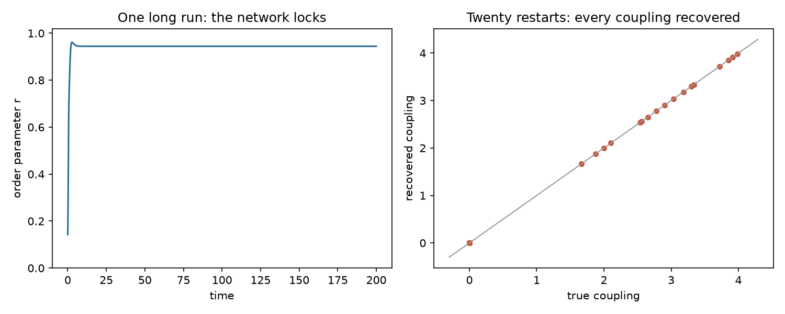
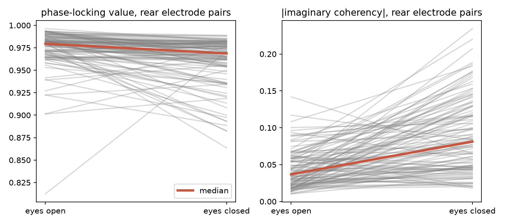
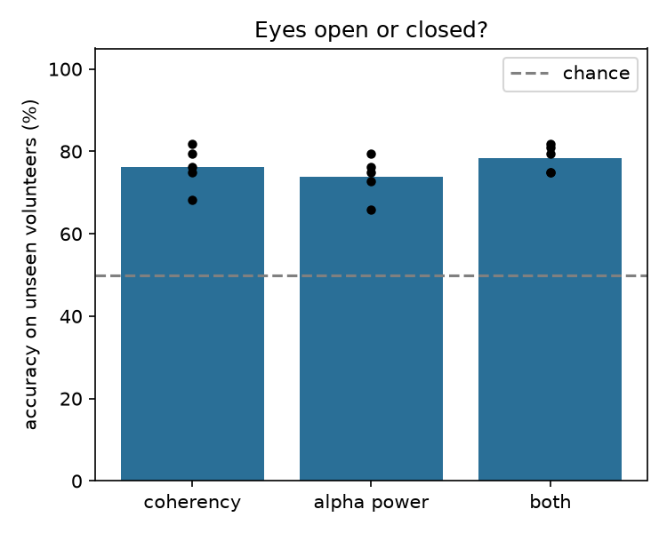

# Synchrony backwards

[](https://github.com/louisjclarke/synchrony-backwards/actions/workflows/tests.yml)
[](https://github.com/louisjclarke/synchrony-backwards/actions/workflows/reproduce.yml)

Most models of synchronisation run forwards: given who is coupled to whom, predict the rhythm. This project runs one backwards. Given only the rhythms, can you work out the couplings, and when can that answer be trusted?

It started with Steven Strogatz's two-line model of Romeo and Juliet, led to the Kuramoto model of coupled oscillators, and ends with open EEG recordings of 109 volunteers.

Every number below is written by the code. The tables sit between markers in this file, and the scripts rewrite them each time they run.

## The model

In the Kuramoto model on a network, oscillator *i* has its own natural frequency ω<sub>i</sub> and is pulled by the oscillators it is coupled to:

dθ<sub>i</sub>/dt = ω<sub>i</sub> + Σ<sub>j</sub> K<sub>ij</sub> sin(θ<sub>j</sub> − θ<sub>i</sub>)

The equation is nonlinear in the phases but **linear in the unknowns** ω<sub>i</sub> and K<sub>ij</sub>. So if the phases are recorded, each time step gives one linear equation, and stacking them gives a linear system **X β = y**:

- each row of X is [1, sin(θ<sub>1</sub> − θ<sub>i</sub>), …, sin(θ<sub>n</sub> − θ<sub>i</sub>)] at one moment,
- y is the measured rate of change of θ<sub>i</sub>,
- β = (ω<sub>i</sub>, K<sub>i1</sub>, …, K<sub>in</sub>) is what we want.

It is solved by least squares, one oscillator at a time.

## Part A: simulations

`part_a.py` simulates an 8-oscillator random network with 18 real links using SciPy's `solve_ivp`, then tries to recover the links.

**Synchrony hides its cause.** Left alone, the network locks. The phase differences stop changing, the columns of X become almost multiples of one another, and the matrix is close to singular: the data no longer fix a single answer. Restarting the network from random phases twenty times, and keeping only the short stretch where it falls into step, fixes this.

**Sparse regression finds the real links.** With measurement noise, plain least squares gives every non-link a small non-zero value. Sequentially thresholded least squares, the algorithm behind SINDy (Brunton et al., 2016), repeatedly sets coefficients below 0.5 to zero and refits on the rest.

<!-- part-a:start -->
| | |
|---|---|
| condition number of X, one locked run | 3.16 × 10<sup>13</sup> |
| condition number of X, twenty restarts (median) | 8.2 |
| largest error in any recovered coupling, twenty restarts | 0.0028 |
| sparse regression with 0.05 rad noise: real links kept | 18 of 18 |
| sparse regression with 0.05 rad noise: false links | 0 |
| plain least squares with 0.05 rad noise: non-links left non-zero | 38 of 38 |
<!-- part-a:end -->



*Left: the order parameter r measures how closely the phases agree. One long run locks within seconds, after which the data carry almost no information about the couplings. Right: couplings recovered from twenty restarts against the true values.*

## Part B: brain rhythms

`part_b.py` uses open data from the PhysioNet EEG Motor Movement/Imagery Dataset: 109 volunteers, 64 electrodes, one minute resting with eyes open and one with eyes closed. It looks at the alpha rhythm (8 to 12 Hz) at eight electrodes over the back of the head, where alpha is strongest. The building blocks are in `eeg.py`.

1. **Phases.** Each signal is band-pass filtered to 8 to 12 Hz, then put through the Hilbert transform. Each electrode's signal becomes a point circling the origin of the complex plane, and its angle is the phase. As a sanity check, alpha power should rise when the eyes close (Berger, 1929).
2. **The old problem returns.** Neighbouring electrodes pick up the same brain sources at the same instant (volume conduction), so their phases move together whether or not anything is coupled. The phase-locking value counts this zero-delay agreement; imaginary coherency does not.
3. **Nolte's check.** Mixing without delay gives a real cross-spectrum, so its imaginary part is zero (Nolte et al., 2004). This is confirmed on synthetic signals, where the answer is known, before trusting it on real ones.
4. **Eyes open against eyes closed.** For every one of the 28 rear electrode pairs, the phase-locking value and |imaginary coherency| are computed over 2-second windows. Each volunteer is compared only with themselves, using a Wilcoxon signed-rank test.
5. **A classifier tested on strangers.** Logistic regression on the 28 coherency values, scored with five-fold cross-validation split by volunteer (`GroupKFold`), so nobody is in both the training and the test set. A baseline using alpha power alone shows whether synchrony adds anything beyond the rhythm's strength.

<!-- part-b:start -->
| | |
|---|---|
| volunteers analysed | 109 |
| alpha power, eyes closed ÷ eyes open (median) | 3.0 times |
| Nolte check, \|imaginary coherency\| with no delay / with delay | 0.007 / 0.979 |
| eyes open, rear pairs: phase-locking value / \|imaginary coherency\| | 0.97 / 0.04 |
| \|imaginary coherency\| higher with eyes closed | 93 of 109 volunteers (Wilcoxon p = 2.4e-14) |
| phase-locking value higher with eyes closed | 20 of 109 volunteers (Wilcoxon p = 3.9e-10) |
| classifier accuracy on unseen volunteers: coherency | 76% (folds 68-82%) |
| classifier accuracy on unseen volunteers: alpha power alone | 74% (folds 66-80%) |
| classifier accuracy on unseen volunteers: both | 78% (folds 75-82%) |
<!-- part-b:end -->

**What the results show.** With eyes open, rear electrode pairs have a phase-locking value of 0.97 but an |imaginary coherency| of only 0.04, so almost all of the apparent synchrony is zero-delay mixing: the same sources reaching neighbouring electrodes at the same instant. When the eyes close, the two measures disagree. Lagged coupling, measured by imaginary coherency, roughly doubles and rises in 93 of 109 volunteers, while the phase-locking value falls slightly in 89 of them. The classifier tells eyes open from closed in unseen volunteers 76% of the time, but alpha power alone manages 74% and the two together 78%: most of what separates the conditions is the strength of the rhythm, and lagged coupling adds a little on top.





## Next: larger networks

For large networks, Restrepo, Ott and Hunt (2005) showed that the coupling strength at which synchrony first appears is set by the largest eigenvalue of the network's adjacency matrix. The next step is to test how well the backwards method works on bigger networks on either side of that threshold.

## Reproducing everything

On GitHub, open **Actions → reproduce → Run workflow**. It runs both parts on GitHub's servers and commits the results, figures and updated tables back to this repository.

Locally:

```bash
pip install -r requirements.txt
python part_a.py            # a few seconds
python part_b.py            # downloads about 300 MB from PhysioNet the first time (speed depends on PhysioNet)
python part_b.py --cached   # reruns the statistics from results/eeg_features.npz in seconds
pytest                      # 7 tests, also run by GitHub on every push
```

| file | contents |
|---|---|
| `synchrony.py` | Kuramoto simulation, the linear system, least squares and sparse regression |
| `eeg.py` | loading the EEG, alpha phases, phase-locking value, imaginary coherency, Nolte's check |
| `part_a.py`, `part_b.py` | the two analyses |
| `report.py` | saves results and writes the tables into this README |
| `tests/` | recovery of couplings, ill-conditioning of locked data, sparse regression, Hilbert phases, Nolte's check, and the whole EEG analysis on synthetic volunteers |
| `results/` | `part_a.json`, `part_b.json`, and the EEG features for every recording |
| `figures/` | the figures above |

## References

- Berger, H. (1929). Über das Elektrenkephalogramm des Menschen. *Archiv für Psychiatrie und Nervenkrankheiten*, 87, 527–570.
- Brunton, S. L., Proctor, J. L. and Kutz, J. N. (2016). Discovering governing equations from data by sparse identification of nonlinear dynamical systems. *PNAS*, 113(15), 3932–3937.
- Goldberger, A. L. et al. (2000). PhysioBank, PhysioToolkit, and PhysioNet. *Circulation*, 101(23), e215–e220.
- Gramfort, A. et al. (2013). MEG and EEG data analysis with MNE-Python. *Frontiers in Neuroscience*, 7, 267.
- Nolte, G. et al. (2004). Identifying true brain interaction from EEG data using the imaginary part of coherency. *Clinical Neurophysiology*, 115(10), 2292–2307.
- Restrepo, J. G., Ott, E. and Hunt, B. R. (2005). Onset of synchronization in large networks of coupled oscillators. *Physical Review E*, 71, 036151.
- Schalk, G. et al. (2004). BCI2000: a general-purpose brain-computer interface (BCI) system. *IEEE Transactions on Biomedical Engineering*, 51(6), 1034–1043.
- Strogatz, S. H. (1988). Love affairs and differential equations. *Mathematics Magazine*, 61(1), 35.
- Strogatz, S. H. (2000). From Kuramoto to Crawford: exploring the onset of synchronization in populations of coupled oscillators. *Physica D*, 143, 1–20.

## Acknowledgement

I first worked through Part A in Python myself, using exercises set by Claude, an AI assistant. The code in this repository was written with Claude's help. I ran the analyses, checked each step and can explain every result.

## Licence

MIT. See `LICENSE`.
